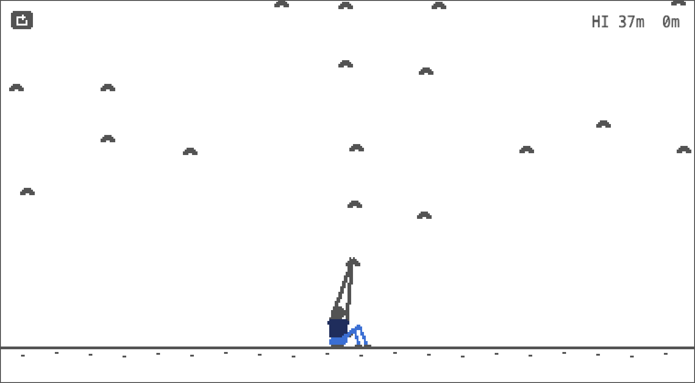

# Free Solo

An endless climbing game: move one hand at a time up the wall and dodge falling rocks.



## Embed

```html
<script type="module" src="https://unpkg.com/free-solo"></script>
<free-solo style="width: 360px; height: 520px"></free-solo>
```

Or from JavaScript:

```js
import { mount } from 'free-solo';

const game = mount(document.getElementById('game'), { keys: 'focus' });
game.pause();    // freeze the climb, stop drawing, ignore keys and taps
game.resume();   // carry on where it left off
game.destroy();
```

| Option | Attribute | Default | Description |
|---|---|---|---|
| `keys` | `keys` | `focus` | `focus`: arrow keys work after the game is clicked. `window`: arrow keys work page-wide. |
| `storageKey` | `storage-key` | `freesolo-best-m` | `localStorage` key for the best height. |
| `active` | | `true` | `false`: draw the wall once, then wait (paused) until `resume()`. |

## Develop

```bash
npm install
npm run build
npm run dev
```

Open http://127.0.0.1:8767 for the game and `/demo.html` for the embeds.
